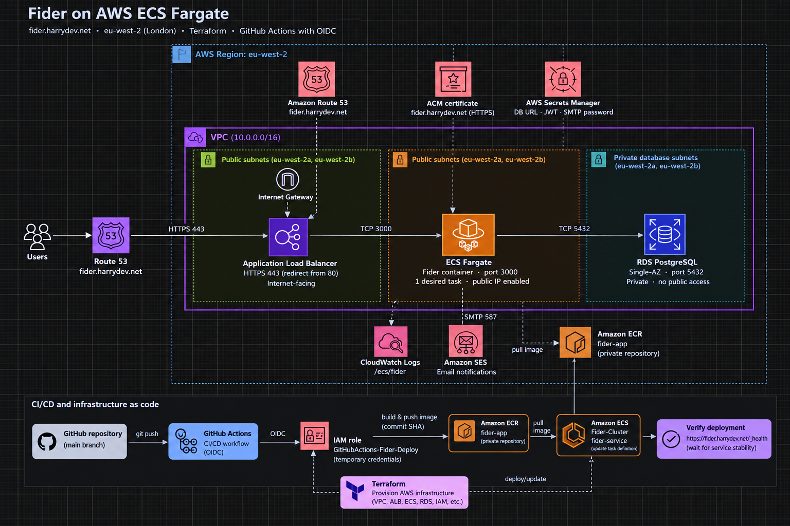
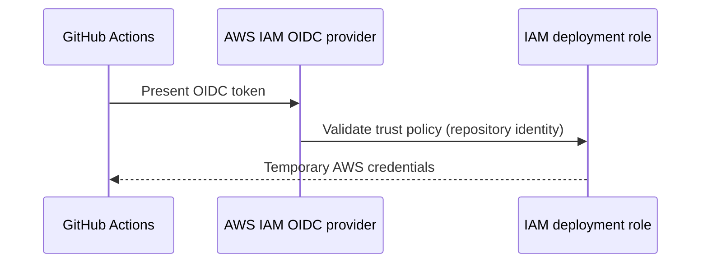
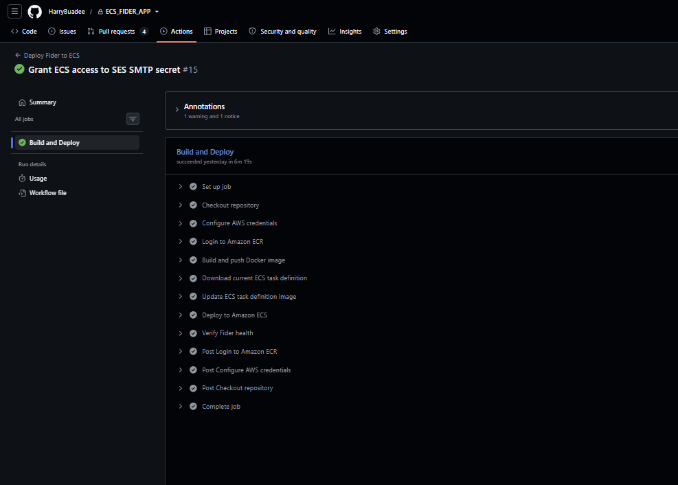
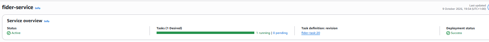
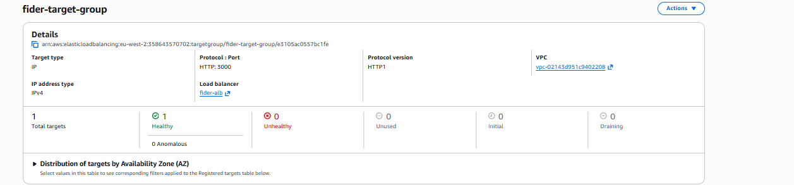
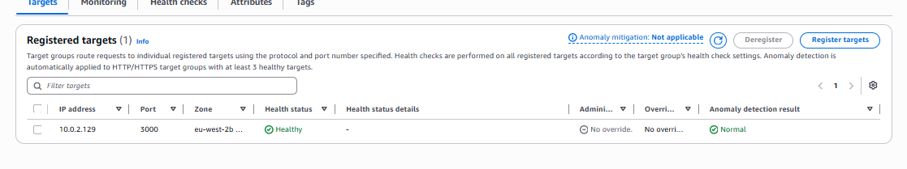
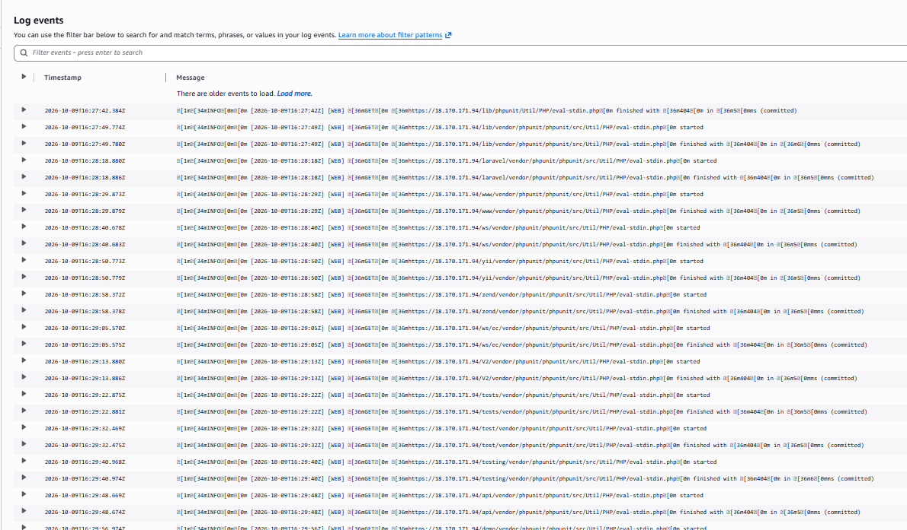

# Fider on AWS ECS: Terraform & CI/CD


A production-style deployment of the open-source [Fider](https://github.com/getfider/fider) feedback platform on AWS. It covers the full lifecycle: local Docker, manual AWS deployment, Infrastructure as Code with Terraform, and an automated CI/CD pipeline triggered by pushes to main, which builds and publishes Docker images to Amazon ECR, deploys updated task definitions to ECS Fargate, and verifies application health.

**Live:** https://fider.harrydev.net

## Contents

- [Architecture](#architecture)
- [What this project covers](#what-this-project-covers)
- [Technology stack](#technology-stack)
- [Repository structure](#repository-structure)
- [AWS infrastructure](#aws-infrastructure)
- [Infrastructure as Code](#infrastructure-as-code)
- [CI/CD pipeline](#cicd-pipeline)
- [Monitoring and health checks](#monitoring-and-health-checks)
- [Local development](#local-development)
- [Deployment verification](#deployment-verification)
- [Screenshots](#screenshots)
- [Skills demonstrated](#skills-demonstrated)
- [Upstream application](#upstream-application)

## Architecture

### Runtime and Deployment



## What this project covers

- Running Fider locally with Docker
- Containerising the application and storing images in Amazon ECR
- Deploying to Amazon ECS on Fargate behind an Application Load Balancer
- Amazon RDS PostgreSQL in private subnets
- HTTPS with AWS Certificate Manager and a custom domain on Route 53
- Application secrets in AWS Secrets Manager and logs in CloudWatch
- Managing the infrastructure with Terraform
- Automated deployments with GitHub Actions
- Keyless AWS authentication from GitHub using OIDC instead of long-lived access keys
- A post-deployment production health check

## Technology stack

| Technology | Purpose |
| --- | --- |
| AWS ECS / Fargate | Container orchestration and serverless compute |
| Amazon ECR | Docker image registry |
| Amazon RDS (PostgreSQL) | Application database |
| Application Load Balancer | Public entry point and traffic distribution |
| AWS Certificate Manager | TLS certificate |
| Route 53 | DNS |
| AWS Secrets Manager | Application secrets |
| CloudWatch Logs | Container logging |
| AWS IAM | Permissions and workload identity |
| Terraform | Infrastructure as Code |
| Docker | Containerisation |
| GitHub Actions + OIDC | CI/CD and keyless AWS authentication |
| NGINX | Local reverse proxy |

## Repository structure

```text
ECS_FIDER_APP/
├── .github/workflows/
│   └── deploy.yml            # CI/CD pipeline
├── fider/                    # Upstream Fider source (see Upstream application)
├── terraform/
│   ├── acm.tf                # TLS certificate
│   ├── alb.tf                # Load balancer, target group, listeners
│   ├── cloudwatch.tf         # Log group
│   ├── ecr.tf                # Image repository
│   ├── ecs.tf                # Cluster, task definition, service
│   ├── iam.tf                # ECS roles and permissions
│   ├── outputs.tf
│   ├── private-subnets.tf    # Database subnets
│   ├── providers.tf
│   ├── rds.tf                # PostgreSQL instance
│   ├── route53.tf            # DNS record
│   ├── secrets.tf            # Secrets Manager resources
│   ├── security-groups.tf    # ALB, ECS and RDS security groups
│   ├── variables.tf
│   └── vpc.tf                # VPC, public subnets, IGW, routes
├── Dockerfile
├── docker-compose.local.yml  # Local Fider + PostgreSQL + MailHog + NGINX
├── nginx.conf
├── .dockerignore
├── .gitignore
└── README.md
```

The upstream Fider source lives under `fider/`. The repository root holds the infrastructure, deployment and CI/CD configuration created for this project.

## AWS infrastructure

### Networking

The application runs in a custom VPC containing:

- Two public subnets in separate Availability Zones for the ALB and ECS tasks
- Two private subnets dedicated to Amazon RDS
- An Internet Gateway and public route table
- Separate security groups for the ALB, ECS tasks and RDS


### Amazon ECS / Fargate

Fider runs as a Fargate service with:

- 1 vCPU and 2 GB memory
- Container port 3000
- CloudWatch logging
- Secrets injected from AWS Secrets Manager
- Application environment variables
- Load balancer integration

The ECS service maintains the desired task count and rolls out new task definition revisions during CI/CD releases.

### Amazon RDS

PostgreSQL runs in dedicated private subnets and accepts connections only from the ECS security group. Credentials are never hard-coded in the task definition; the connection string is retrieved from Secrets Manager at runtime.

### Secrets management

The ECS task execution role retrieves `DATABASE_URL` and `JWT_SECRET` from AWS Secrets Manager. Secrets are never baked into the Docker image or committed to the repository.

### Load balancing, HTTPS and DNS

- HTTP on port 80 returns a `301` redirect to HTTPS on port 443
- The HTTPS listener uses an ACM certificate and forwards to the target group on port 3000
- The target group health check uses `/_health`
- Route 53 maps `fider.harrydev.net` to the load balancer

## Infrastructure as Code

Terraform manages:

- VPC, subnets, Internet Gateway, route tables and security groups
- ECR repository, ECS cluster, baseline task definition and service
- RDS, Application Load Balancer, target group and listeners
- Route 53 record, ACM certificate, CloudWatch log group
- Secrets Manager resources and ECS IAM permissions

Typical workflow:

```bash
cd terraform
terraform fmt
terraform validate
terraform plan
terraform apply
```

After the existing infrastructure was imported and aligned with the configuration, `terraform plan` reported no drift:

```text
No changes. Your infrastructure matches the configuration.
```

That gives a reproducible baseline instead of relying on manual console configuration.

## CI/CD pipeline

Every push to `main` triggers the GitHub Actions workflow in `.github/workflows/deploy.yml`:

1. Authenticate to AWS using OIDC
2. Build the Docker image
3. Tag the image with the Git commit SHA
4. Push the image to Amazon ECR
5. Retrieve the current ECS task definition
6. Replace the container image
7. Register a new task definition revision
8. Update the ECS service
9. Wait for service stability
10. Run the production health check

Tagging with the commit SHA links every running deployment back to the exact source revision that produced it.

### Keyless authentication with GitHub OIDC

Instead of storing AWS access keys as GitHub secrets, the workflow exchanges a short-lived GitHub identity token for temporary AWS credentials:



The deployment role is limited to what the pipeline needs:

- Push images to the Fider ECR repository
- Read and register ECS task definitions
- Update the Fider ECS service
- Pass the ECS task execution role

### Terraform and CI/CD ownership

Terraform and GitHub Actions must not fight over task definition revisions. Terraform owns the infrastructure and a baseline task definition. GitHub Actions owns application releases and registers new revisions with each new image. The ECS service therefore ignores task definition changes in Terraform:

```hcl
lifecycle {
  ignore_changes = [
    task_definition
  ]
}
```

Without this, a later `terraform apply` could roll the service back to an older revision.

| Owner | Responsibility |
| --- | --- |
| Terraform | AWS infrastructure, ECS service, baseline task definition |
| GitHub Actions | Application image, new task definition revisions, releases |

## Monitoring and health checks

- Container logs go to the `/ecs/fider` log group in CloudWatch Logs
- `/_health` is used for both ALB target health checks and the post-deployment CI/CD check
- A healthy response looks like this:

```json
{"status":"Healthy"}
```

A green pipeline therefore means more than "an image was pushed": the new deployment is reachable and reporting healthy.

## Local development

The local stack runs Fider, PostgreSQL, MailHog and an NGINX reverse proxy.

```bash
docker build -t fider-app:local .
docker compose -f docker-compose.local.yml up -d
docker ps
```

NGINX exposes the application locally on port 80.

## Deployment verification

Check the production health endpoint:

```bash
curl https://fider.harrydev.net/_health
```

Expected response:

```json
{"status":"Healthy"}
```

Check the ECS service:

```bash
aws ecs describe-services \
  --cluster Fider-Cluster \
  --services fider-service \
  --region eu-west-2
```

## Deployment Screenshots

### Successful GitHub Actions Deployment

The GitHub Actions pipeline builds the Docker image, pushes it to Amazon ECR, deploys the application to ECS Fargate, and verifies application health.



### Amazon ECS Fargate Service

The ECS service shows one running task, zero pending tasks, and a successful deployment.



### Application Load Balancer Target Group

The ALB target group uses HTTP on port 3000 and reports one healthy registered target.



### Application Load Balancer Target Health

The registered Fider ECS target is healthy and running in the eu-west-2b Availability Zone.



### Amazon CloudWatch Logs

CloudWatch collects application logs from the Fider ECS container for monitoring and troubleshooting.



## Skills demonstrated

- **Cloud:** AWS networking, security groups, ECS/Fargate, RDS, ALB, ACM, Route 53, IAM, Secrets Manager
- **Infrastructure as Code:** Terraform, importing existing resources, resolving state drift
- **CI/CD:** GitHub Actions, OIDC federation, image tagging and release traceability
- **Containers:** Docker, Amazon ECR
- **Operations:** CloudWatch troubleshooting, health checks, production debugging
- **Tooling:** Linux, command line, Git and GitHub

## Upstream application

This project uses [Fider](https://github.com/getfider/fider), an open-source customer feedback platform, as the application workload. The upstream source and its original documentation are retained under `fider/`, and remain subject to the upstream licence in `fider/LICENSE`.

This repository focuses on the containerisation, AWS infrastructure, Infrastructure as Code and CI/CD around the application.
